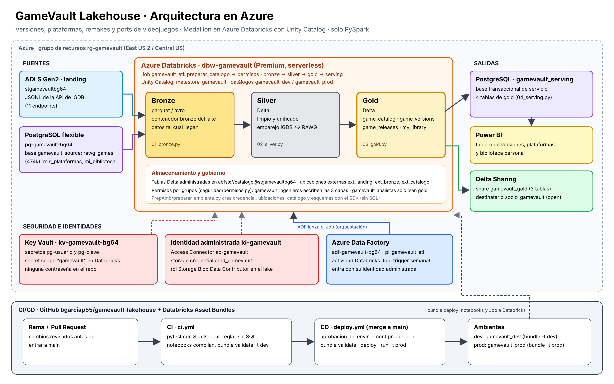

# gamevault-lakehouse

Lakehouse de videojuegos en Azure Databricks: para cada juego, sus versiones, plataformas, remakes, remasters y ports, cruzado con una biblioteca personal.

- **Fuentes:** PostgreSQL (catálogo RAWG y biblioteca personal) y ADLS Gen2 (JSONL de la API de IGDB).
- **Capas:** bronze (parquet o avro), silver y gold (Delta), bajo Unity Catalog.
- **Regla:** solo PySpark, sin Spark SQL ni SQL en ningún archivo. `tests/test_solo_pyspark.py` lo verifica en cada pull request.
- **Orquestación:** Azure Data Factory lanza el Job de Databricks cada semana.
- **Salidas:** gold se publica en PostgreSQL (`gamevault_serving`) para Power BI y se comparte con un socio por Delta Sharing.
- **Seguridad:** identidades administradas (sin claves en el código), secretos en Key Vault y permisos por grupos en Unity Catalog.
- **Despliegue:** Databricks Asset Bundle con targets `dev` y `prod`, y GitHub Actions para CI y CD (prod con aprobación).

## Arquitectura



Resumen en texto:

```
 ADLS Gen2 (landing/igdb/*.jsonl) ──┐
                                    ├─> Databricks (PySpark) ─> bronze (parquet/avro)
 PostgreSQL (rawg_games,           ─┘                          ─> silver (Delta)
   mis_plataformas, mi_biblioteca)                             ─> gold (Delta)
                                                                   ├─> PostgreSQL gamevault_serving ─> Power BI
                                                                   └─> Delta Sharing (socio)
 Orquestación: Azure Data Factory lanza el Job gamevault_etl de Databricks.
 CI/CD: GitHub Actions + Asset Bundles (dev -> prod).
```

## Estructura

```
databricks-app/
  databricks.yml                 bundle: variables y targets dev / prod
  resources/gamevault_etl.job.yml  Job: preparar_catalogo -> permisos y bronze -> silver -> gold -> serving
  PrepAmb/preparar_ambiente.py   crea credencial, ubicaciones externas, catálogo y esquemas (SDK, sin SQL)
  PrepAmb/metastore.md           cómo se creó el metastore propio de Unity Catalog
  proceso/01_bronze.py           fuentes -> bronze
  proceso/02_silver.py           bronze -> silver
  proceso/03_gold.py             silver -> gold
  proceso/04_serving.py          gold -> PostgreSQL (gamevault_serving) para Power BI
  proceso/gamevault/             paquete con la lógica (config, fuentes, silver, gold, tablas)
  reversion/revertir_ambiente.py borra tablas, rutas físicas, Volumes y esquemas
  datasets/                      insumos: descarga de IGDB, origen de RAWG, plantillas de la biblioteca
                                 y el notebook que carga la base de origen en PostgreSQL
  seguridad/permisos.py          permisos de Unity Catalog y del Job para dos grupos (SDK, sin GRANT)
  delta-sharing/                 share de gold para un socio y cómo lo lee el socio
  adf/                           plantilla ARM de Data Factory (linked service, canalización y desencadenador)
  dashboard/                     tablero de Power BI sobre gamevault_serving
  certificaciones/               certificaciones de Databricks
  evidencias/                    capturas de corridas, Actions, servicios de Azure y arquitectura
  tests/                         pruebas con Spark local (pytest)
.github/workflows/ci.yml         (en la raíz del repo) pruebas y validación del bundle en cada PR
.github/workflows/deploy.yml     (en la raíz del repo) CD: despliega y ejecuta en prod al entrar a main
```

`.github/` queda en la raíz del repo porque GitHub solo lee los workflows desde ahí.

## Tablas

| Capa | Tablas |
| --- | --- |
| bronze (parquet/avro) | una carpeta por endpoint de IGDB y por tabla de PostgreSQL |
| silver (Delta) | `game_types`, `platforms`, `games`, `game_relations`, `releases`, `time_to_beat`, `rawg_games`, `rawg_game_platforms`, `source_ids`, `my_platforms`, `my_library` |
| gold (Delta) | `game_catalog`, `game_versions`, `game_releases`, `my_library` |

## Etapas

| | Etapa 1: `modo_fuente=volume` | Etapa 2: `modo_fuente=externo` |
| --- | --- | --- |
| JSONL de IGDB | `/Volumes/<catálogo>/bronze/raw/igdb/<endpoint>/` | `abfss://landing@<cuenta>.dfs.core.windows.net/igdb/<endpoint>/` |
| RAWG y biblioteca | `/Volumes/<catálogo>/bronze/raw/postgres/<tabla>.csv` | PostgreSQL con el conector `postgresql` |
| Salida de bronze | `/Volumes/<catálogo>/bronze/archivos/` | `abfss://bronze@<cuenta>.dfs.core.windows.net/` |

Para pasar a la etapa 2 solo cambian las variables del bundle; el código de bronze, silver y gold es el mismo.

## Recursos de Azure (etapa 2)

| Recurso | Nombre | Para qué |
| --- | --- | --- |
| Grupo de recursos | `rg-gamevault` | Agrupa todo el proyecto |
| ADLS Gen2 | `stgamevaultbg64` | Contenedores `landing` (fuente IGDB), `bronze` y `catalogo` (tablas Delta) |
| PostgreSQL flexible | `pg-gamevault-bg64` | Bases `gamevault_source` (fuente 2) y `gamevault_serving` (salida para Power BI) |
| Key Vault | `kv-gamevault-bg64` | Secretos `pg-usuario` y `pg-clave`, leídos desde el secret scope `gamevault` |
| Identidad administrada | `id-gamevault` | Identidad con *Storage Blob Data Contributor* sobre el data lake |
| Access Connector | `ac-gamevault` | Puente entre Databricks y la identidad (storage credential `cred_gamevault`) |
| Azure Databricks | `dbw-gamevault` | Workspace Premium con Unity Catalog (metastore propio `metastore-gamevault`) |
| Data Factory | `adf-gamevault-bg64` | Orquesta el Job con su identidad administrada (ver `adf/`) |

## Cómo desplegar en Azure

1. **Datos de origen:** los JSONL de IGDB en `landing/igdb/<endpoint>/` y los tres CSV en `landing/postgres/`; después corre una vez `datasets/postgres/cargar_en_postgres.py` para crear las tablas de la base de origen.
2. **Dev:** `databricks bundle deploy -t dev` y `databricks bundle run gamevault_etl -t dev` (o desde el panel Deployments de la Git folder). `PrepAmb` crea las ubicaciones externas, el catálogo en el data lake y sus esquemas.
3. **Prod:** un merge a `main` dispara `deploy.yml`, que pide aprobación en el environment `produccion` y despliega y corre el Job en `gamevault_prod`.
4. **Seguridad:** crea los grupos `gamevault_ingenieros` y `gamevault_analistas` (Settings > Identity and access > Groups); la tarea `permisos` del Job les da los permisos en cada corrida. Ver `seguridad/README.md`.
5. **Delta Sharing:** activa el sharing externo del metastore y corre `delta-sharing/compartir_gold.py` con `gamevault_prod`. Ver `delta-sharing/README.md`.
6. **Orquestación:** la plantilla ARM de `adf/` crea el linked service, la canalización y el desencadenador semanal de Data Factory.

### Decisiones por la suscripción de prueba

- **Cómputo serverless:** la suscripción de prueba no tenía capacidad para máquinas virtuales en East US 2 (`CLOUD_PROVIDER_RESOURCE_STOCKOUT`), así que el Job corre en serverless, que no necesita VMs propias. Para usar un clúster basta agregar `job_clusters` al Job.
- **Conector `postgresql`:** serverless no permite escribir con `format("jdbc")`; se usa el conector nativo `postgresql` para leer el origen y publicar gold.
- **PostgreSQL en Central US:** East US 2 no permitía crear el servidor en la suscripción de prueba.

## Cómo desplegar en Free Edition (etapa 1)

Todos los comandos se corren dentro de `databricks-app/`.

1. Instala la [CLI de Databricks](https://docs.databricks.com/aws/en/dev-tools/cli/install) e inicia sesión:
   `databricks auth login --host https://<tu-workspace>`
   (o, desde una Git folder del workspace, abre `databricks-app/databricks.yml` y usa el panel Deployments).
2. Despliega con el target `free`: `databricks bundle deploy -t free`
3. En Free Edition, crea primero el catálogo `gamevault_dev` desde Catalog > + > Create catalog (Default Storage); por código no se puede. Después crea los esquemas y los Volumes corriendo solo la primera tarea: `databricks bundle run gamevault_etl -t free --only preparar_catalogo`
4. Sube los datos al Volume `bronze.raw` (Catalog Explorer > Upload) con esta forma (ver `datasets/README.md`):
   - `igdb/games/*.jsonl`, `igdb/platforms/*.jsonl`, ... (lo que genera `datasets/igdb/igdb_descarga.py`)
   - `postgres/rawg_games.csv` (el CSV de RAWG de Kaggle, renombrado)
   - `postgres/mis_plataformas.csv` y `postgres/mi_biblioteca.csv` (copia las de `datasets/postgres/` y edítalas)
5. Corre el Job completo: `databricks bundle run gamevault_etl -t free`

## CI/CD

| Workflow | Cuándo corre | Qué hace |
| --- | --- | --- |
| `ci.yml` | cada pull request y cada push a main | pruebas PySpark con pytest; si hay workspace configurado, `bundle validate -t dev` |
| `deploy.yml` | cada push a main (y a mano) | `bundle validate`, `bundle deploy` y `bundle run` en prod |

`deploy.yml` hace lo mismo que el script de referencia del curso (script3.yml: exportar notebooks, importarlos en el destino, recrear el Job y ejecutarlo), pero con Asset Bundles, que actualizan el Job en lugar de borrarlo y recrearlo.

Para activarlo, en GitHub (Settings > Secrets and variables > Actions):
- variable `DATABRICKS_HOST` con la URL del workspace;
- secreto `DATABRICKS_TOKEN` con un token de acceso personal;
- environment `produccion` (Settings > Environments), donde se puede exigir aprobación antes de desplegar.

En Azure no hay que preparar nada para prod: `PrepAmb` crea el catálogo `gamevault_prod` en el data lake y las fuentes son las mismas que en dev.

## Reversión

`reversion/revertir_ambiente.py` borra, en orden, las tablas de gold, silver y bronze, los archivos físicos de bronze, los Volumes (opcional) y los esquemas. Solo corre si se escribe `BORRAR` en el widget `confirmar`. El catálogo se borra desde la interfaz.

## Ejecuciones

| Fecha | Ambiente | Resultado |
| --- | --- | --- |
| 2026-11-03 | Free Edition, `gamevault_dev` | Job completo en 3m44s. Bronze: 17.356 juegos IGDB, 74.847 lanzamientos, 474.417 filas RAWG. Silver: 10.322 juegos IGDB con pareja en RAWG (59 %). |
| 2026-11-03 | Free Edition, `gamevault_dev` | Corrección de relaciones duplicadas: Ocarina of Time muestra 3 versiones correctas (1 addon, Master Quest, y 2 remakes) |
| 2026-11-13 | Azure, `gamevault_dev` (serverless) | Job completo en 3m37s leyendo de ADLS y PostgreSQL. Mismos conteos que Free Edition; gold publicado en `gamevault_serving` (game_releases 72.956 filas). Evidencia: `evidencias/job_etl_dev_ok.png`. |
| 2026-11-13 | Azure, `gamevault_prod` | CD de GitHub Actions (merge del PR #9, con aprobación del environment `produccion`) desplegó y corrió el Job en 6m13s. ADF lanzó el Job desde `pl_gamevault_etl` (3m42s). Permisos de grupos y share de Delta Sharing aplicados. |

## Uso de herramientas de IA

Este proyecto se desarrolló con apoyo de Claude (Anthropic) como asistente de programación. El historial de commits y los pull requests lo muestran.

- **Autor:** definió el tema, las fuentes, la arquitectura y las decisiones de diseño; desplegó y ejecutó el ETL en Databricks y validó los resultados (conteos, casos como Ocarina of Time).
- **Claude:** propuso la estructura y redactó buena parte del código PySpark, las pruebas, los workflows y la documentación, que el autor revisó y aprobó en cada pull request.

## Pruebas locales

Requiere Python 3.11 y Java 17. Desde `databricks-app/`:

```
pip install -r requirements-dev.txt
pytest
```
